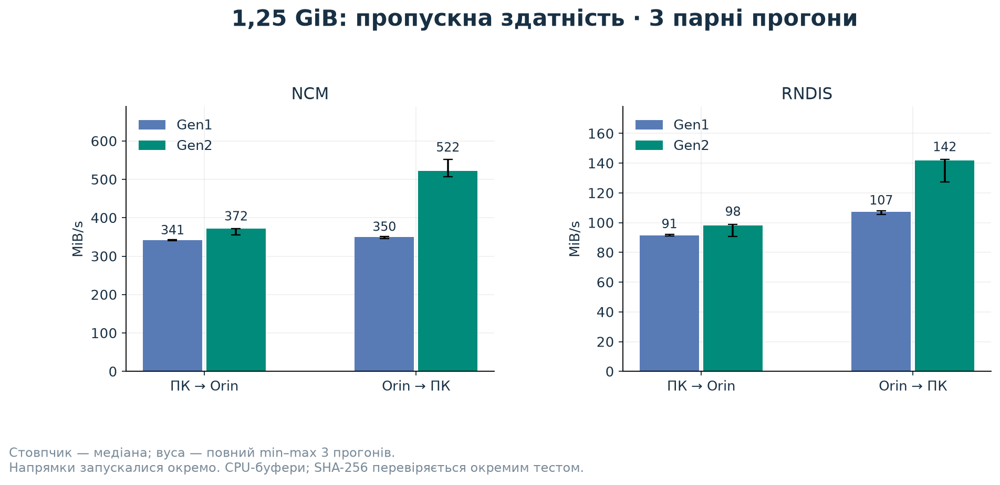
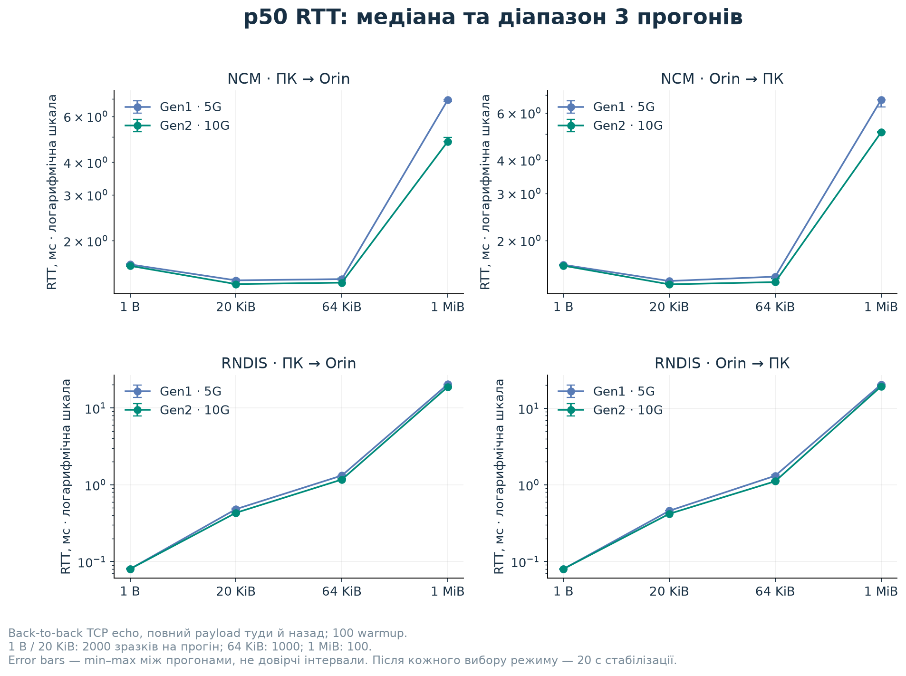
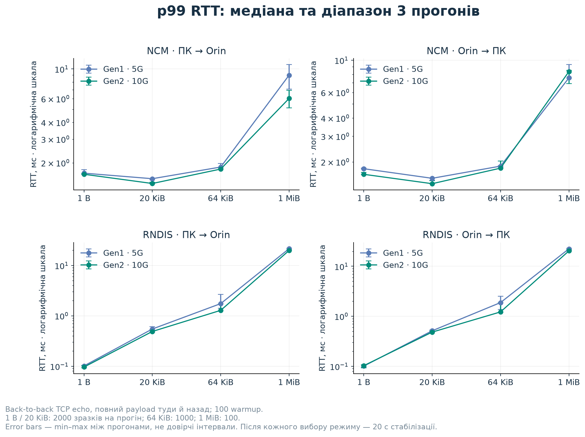
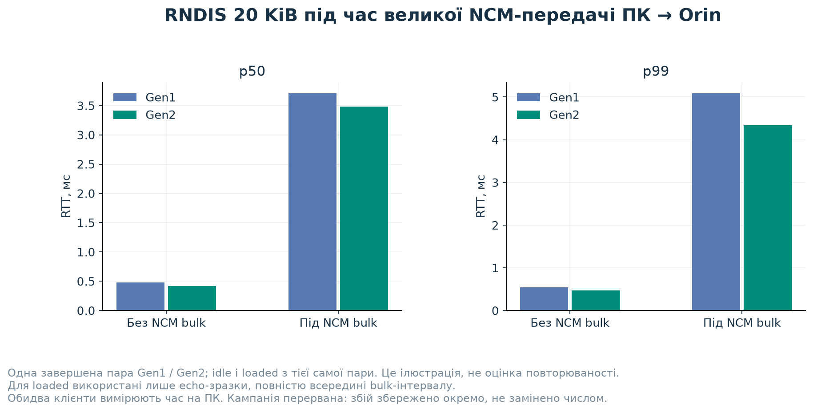

# Expanded Gen1 / Gen2 benchmark campaign

The original results in RESULTS.md were exploratory and one final controlled transfer per arm. This follow-up uses a predefined repeated schedule. It measures synthetic CPU-buffer TCP behavior, not GPU staging or inference throughput.

## Reproduce

Requirements: the working patched driver and `orin-usb-gen2` CLI already installed on Orin; independent management SSH to both machines; distinct NCM/RNDIS IPs and verified neighbors. This campaign does not install a driver or change boot policy. It switches runtime generation and reapplies/restores the original host RPS masks.

Copy `bench/config.example.json` **outside the repository**, replace SSH targets and interface names/IPs with your own, and keep it private. The example interface names are placeholders. Never put passwords in the config. The controller asks for each sudo password using `getpass` and passes it only over SSH stdin; credentials are not written to results.

```sh
python3 bench/campaign.py --config /path/to/private-config.json --out /tmp/orin-smoke --smoke
python3 bench/campaign.py --config /path/to/private-config.json --out /tmp/orin-campaign
python3 bench/analyze_campaign.py /tmp/orin-campaign
# Optional plotting dependency, not required for measurement:
python3 bench/plot_campaign.py /tmp/orin-campaign --out /tmp/orin-figures
```

The full schedule can take tens of minutes and would transfer roughly135GiB of application payload over USB if completed. It does not reboot or stop unrelated workloads. `--out` refuses to overwrite an earlier raw dataset. Use a new directory for each attempt; do not silently replace failed runs.

For standalone probes, `suite_probe.py` has `server`, `latency`, and `bulk` roles. `--quick` is only a smoke test. Server/client use explicit USB IPs. TCP ports45682–45684 must be available. Measurement processes run as the SSH user; the separate root control process only changes mode through the existing guarded CLI, restores RPS, and reads diagnostics.

## Schedule and measurement definitions

Six pairs alternate `[Gen1, Gen2]`, `[Gen2, Gen1]`, repeated three times. Each generation block has a fixed20-second settling interval, followed by ARP warmup outside the measurement. Same host/device, port, driver, NCM timer/NTB settings, qmult, MTU and RPS; a cross-generation baseline guard rejects changes.

- **Unloaded echo**, NCM and RNDIS, each endpoint initiating:1B,20KiB,64KiB,1MiB. Respectively2000/2000/1000/100 measured RTTs after100 warmups. One persistent TCP_NODELAY connection per sweep, back-to-back closed-loop traffic. Every echoed payload is compared byte-for-byte. RTT is one client's monotonic elapsed time, including both complete payload directions; no one-way latency inference.
- **Bulk:**1.25GiB, each direction separately on NCM and RNDIS.1MiB reusable buffer, final receiver byte-count acknowledgment. Setup/SSH transport is outside the timed data path. This is byte-count validation, not a hash test.
- **NCM duplex:** two1.25GiB clients launched concurrently. Before/after SSH exchanges bracket clock-offset estimates; raw client intervals provide a conservative overlap estimate conditional on those brackets. Do not add per-flow rates and label the sum guaranteed simultaneous wire bandwidth.
- **Loaded latency:** pairs1 and4 only. Host-initiated RNDIS20KiB echo while a separate host→Orin NCM client streams4GiB. Both clients use the same host monotonic clock. Retain only RTT samples wholly within the bulk interval; recompute percentiles from retained samples. Compare with unloaded data from those same two pairs. These are **two paired repetitions**, not six.

Each trial checks route, peer MAC, interface identity, actual data-byte deltas and stable settings. Error/drop counters and CPU/load/temperature context are recorded. Optional unavailable temperatures are null, never zero. Published records omit SSH aliases, IP/MAC addresses, serials and credentials.

Raw per-run RTT percentiles use nearest rank. Summary figures use medians and min–max ranges **between runs**. Thousands of RTT samples within a run are not thousands of independent experimental repetitions. No confidence interval or general hardware-population claim is inferred from six runs on one shared setup.

## Failed initial attempt and protocol revision

The initial full attempt completed its first Gen1 block, then the first Gen2 NCM echo trial timed out shortly after re-enumeration. Host NCM/RNDIS reported NETDEV WATCHDOG; connectivity later recovered without another mode change. The timeout is retained in the preliminary dataset and remains a stability finding, not a discarded inconvenient latency value.

A subsequent complete Gen2 echo probe after settling passed. Before restarting the entire paired series, protocol revision2 added the same fixed20-second settling interval to every block. The resulting comparison is **after a fixed20-second delay**, not immediate post-switch readiness. This does not establish the watchdog's root cause or prove all mode switches reliable. Two earlier smoke failures (an unavailable sysfs temperature sensor and an initially empty ARP cache) were instrumentation/preflight failures, not benchmark observations; their handling was corrected before the full campaign.

## Data and interpretation

See `results/campaign-2026-10-26/PLAN.md` for the plan/revision and retained preliminary attempt. The retained run is incomplete; the explicitly labeled partial analysis below uses only complete pairs. A separate full-payload SHA-256 test is required after measurement; raw bulk byte counts alone do not establish payload integrity.

## Observed outcome: stopped during pair 4

**The six-pair campaign did not finish.** Revision2 collected74 valid records, then failed during the Gen2 mixed NCM/RNDIS load trial in pair4. The last host enumeration was23:20:50; both TX queues reported NETDEV WATCHDOG at23:24:17, about207 seconds later. The fixed settling delay therefore does not eliminate the failure. The root cause is open: these observations do not distinguish XUDC, host/network queue handling, or interference from concurrent work.

Orin's journal also shows unrelated `drop_caches=3` activity beginning23:23:15. We did not issue those calls, stop their owner, or establish a causal relationship. These were shared systems, not a controlled idle-host stress test. After the failed run, NCM/RNDIS ping recovered without another mode change. Gen2, permanent enablement and original host RPS masks were retained; no reboot was performed.

The final **descriptive comparison uses the longest fully completed paired prefix: pairs1–3**. It contains64 valid records,122,400 unloaded measured RTTs and4,000 qualified loaded RTTs. The remaining10 valid Gen2 records from pair4 stay in the raw file, but do not get an unmatched Gen1 comparison. The failed record remains there too. This rule was added after the campaign aborted; it does not convert the planned six-pair study into a completed one or estimate failure probability.

`summary.json` is reproducible with the explicit partial-analysis option:

```sh
python3 bench/analyze_campaign.py results/campaign-2026-10-26 --allow-incomplete
python3 bench/plot_campaign.py results/campaign-2026-10-26 --out /tmp/orin-figures
```

Without that flag the analyzer rejects this aborted campaign. It checks exact schedule order and completeness of every included pair. Three repeats describe this setup's observed spread; they are not population statistics. Loaded latency has **one completed pair**, not three or six. An additional Gen2 loaded attempt failed.

### Bulk throughput

Median [min–max] MiB/s across three runs per generation; separate directions,1.25GiB each:

| Transport / direction | Gen1 | Gen2 | Median paired Gen2/Gen1 |
|---|---:|---:|---:|
| NCM host→Orin | 341.3 [340.4–342.9] | 372.0 [355.2–372.1] | 1.085× |
| NCM Orin→host | 349.9 [345.6–351.7] | 522.1 [506.3–551.5] | 1.492× |
| RNDIS host→Orin | 91.3 [91.1–92.0] | 98.2 [90.7–98.9] | 1.078× |
| RNDIS Orin→host | 107.4 [105.5–107.9] | 141.9 [127.5–142.4] | 1.320× |

The ratio column is the median of pairwise ratios, not the ratio of the two marginal medians. NCM transfer-time medians were3.750→3.440s host→Orin and3.658→2.452s Orin→host. A10G link did not double application bandwidth.



### Unloaded latency

Host-initiated echo; each cell is median across runs of per-run **p50 / p99**, in milliseconds:

| Payload | NCM Gen1 | NCM Gen2 | RNDIS Gen1 | RNDIS Gen2 |
|---|---:|---:|---:|---:|
| 1B | 1.624 / 1.675 | 1.603 / 1.644 | .080 / .101 | .080 / .096 |
| 20KiB | 1.411 / 1.523 | 1.365 / 1.403 | .482 / .547 | .431 / .489 |
| 64KiB | 1.427 / 1.860 | 1.382 / 1.797 | 1.318 / 1.745 | 1.169 / 1.283 |
| 1MiB | 6.925 / 8.986 | 4.801 / 6.030 | 20.248 / 21.465 | 18.721 / 19.765 |

The1MiB per-run p99 comes from just100 observations: it is a coarse tail estimate. Every echo includes the complete payload in both directions. The arrows in the figures identify the initiating client, not one-way timing. NCM timer remained400µs; this is not a new timer-tuning experiment. RNDIS gave lower short-message RTT; NCM was faster for large messages and bulk.




### Duplex and loaded latency

Concurrent NCM per-flow median [min–max] MiB/s:

| Flow | Gen1 | Gen2 |
|---|---:|---:|
| Host→Orin | 186.3 [178.8–187.8] | 266.4 [242.8–275.7] |
| Orin→host | 318.8 [316.9–323.4] | 505.9 [396.6–575.3] |

Estimated overlap bounds spanned3.715–4.045s across Gen1 trials and1.965–3.231s across Gen2 trials. The widest clock-calibration bracket was21.2ms. These are conditional overlap estimates, not synchronized hardware timestamps. Per-flow durations differ; summing their average rates would not establish a common-interval aggregate rate.

For the single completed loaded pair, RNDIS20KiB echo during host→Orin4GiB NCM bulk changed as follows (p50 / p99 milliseconds):

| Generation | Paired unloaded | Loaded |
|---|---:|---:|
| Gen1 | .477 / .539 | 3.714 / 5.093 |
| Gen2 | .418 / .470 | 3.480 / 4.340 |

All2000 measured echoes per arm qualified as fully inside the bulk interval. Separate network interfaces on the same USB device did not isolate latency from bulk activity. This is an observation from one successful pair; the later Gen2 mixed-load failure limits any reliability claim.



### Environment, integrity and retained evidence

Selected-pair host one-minute load averages ranged6.64–14.27 on a32-logical-CPU Ryzen9 5950X; Orin ranged1.11–4.76. Load average is not percent CPU utilization. Maximum per-record RX-drop deltas were101 on the host and903 on Orin; overlapping duplex records share counter windows and must not be summed. These measurements are not zero-packet-loss results.

After the aborted campaign, separate1.25GiB NCM SHA-256 transfers succeeded once in each direction atGen2. The complete digest matched the earlier probe's deterministic payload. See `integrity.json`; hash timing is not included in the bulk table. This checks those two payloads and does not rule out intermittent stalls.

Published under [`results/campaign-2026-10-26`](../results/campaign-2026-10-26/): original manifest with `complete:false`, all raw records, derived summary, sanitized kernel excerpts, post-campaign integrity checks, and the failed initial attempt in `preliminary/`. Raw results are compressed JSON Lines. Dates/timestamps for the measured runner were less detailed than the final public controller: the latter now records UTC start/end and isolates its management SSH process from terminal Ctrl-C. Probe bytes and the measurement protocol are unchanged; cancellation was not hardware-tested in this campaign.
